<div align="center">

# ⚡ Quoc Zai (`@quoczai22`)
### DevOps • Cloud Infrastructure • AI & Software Engineering

<p align="center">
  
</p>

---

### 📡 Real-time Cluster Topology & Inbound Telemetry
<p align="center">
  <picture>
    <source media="(prefers-color-scheme: dark)" srcset="./dist/devops-3d-network.svg" />
    <source media="(prefers-color-scheme: light)" srcset="./dist/devops-3d-network.svg" />
    
  </picture>
</p>

---

</div>

### 🛠️ Core Tech Stack & Tools

```text
Languages     :: Python • PHP • JavaScript • TypeScript • C/C++ • Shell
DevOps & Net  :: Docker • Kubernetes • GitHub Actions • Linux • CI/CD • BGP/Mesh
AI & Workflow :: Agent Workflows • Machine Learning • Data Pipelines
```

<div align="center">
  <sub>⚡ Auto-synchronized every 12 hours via GitHub Actions • Built with pure Python & SVG Isometric 3D</sub>
</div>
