<div align="center">

# 🍄 Quoc Zai (`@quoczai22`)
### Software Engineer • AI Architect • DevOps Adventurer

<p align="center">
  
</p>

---

### 🎮 Mario Contribution World (World 1-1)
<p align="center">
  <picture>
    
  </picture>
</p>

---

</div>

### 🛠️ Core Tech Stack & Weapons

```text
★ Languages     :: Python • PHP • JavaScript • TypeScript • C/C++ • Shell
★ AI & Machine  :: Machine Learning • Agent Workflows • Digital Heritage AI
★ Cloud & Tools :: Docker • Kubernetes • GitHub Actions • Linux CI/CD
```

<div align="center">
  <sub>🍄 Mario calculates real parkour physics across your commits • Auto-synchronized every 12 hours</sub>
</div>
