<div align="center">

# 🍄 Super Quoc Zai World (`@quoczai22`)
### Level 99 Developer • AI Engineer • DevOps Adventurer

<p align="center">
  
</p>

---

### 🎮 Super Mario Commits: World 1-1
<p align="center">
  <picture>
    <source media="(prefers-color-scheme: dark)" srcset="./dist/mario-commits.svg" />
    <source media="(prefers-color-scheme: light)" srcset="./dist/mario-commits.svg" />
    
  </picture>
</p>

---

</div>

### 🎒 Inventory & Power-ups (Tech Stack)

```text
★ Primary Weapons :: Python • JavaScript • TypeScript • PHP • C/C++
★ Power-up Items  :: Docker • Kubernetes • GitHub Actions • Linux CI/CD
★ Special Skills  :: Machine Learning • Agent Workflows • Digital Heritage AI
```

<div align="center">
  <sub>🍄 Mario auto-syncs every 12 hours via GitHub Actions • Built with pure Python & SVG Pixel Art</sub>
</div>
